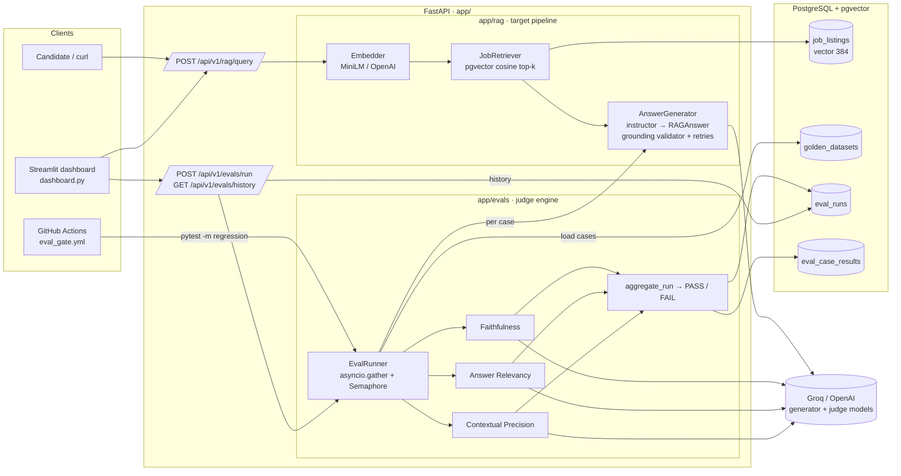

# EvalPipeline Pro

Production-grade **Automated LLM Output Quality & RAG Evaluation Suite** for a career / job-matching
RAG pipeline. It scores every answer with **LLM-as-a-Judge** metrics (Faithfulness, Answer Relevancy,
Contextual Precision), forces all LLM output into **strict Pydantic schemas** with automatic retries,
stores run history in **PostgreSQL + pgvector**, and blocks pull requests in **GitHub Actions** when
quality drops below a configurable threshold (default **0.85**).

| Layer | Tech |
|---|---|
| API | Python 3.9, FastAPI, Uvicorn, Pydantic v2, asyncio |
| Data | PostgreSQL 16 + pgvector (HNSW, cosine), SQLAlchemy 2 async, asyncpg |
| RAG | `sentence-transformers/all-MiniLM-L6-v2` (local, 384-d) or OpenAI embeddings; Groq / OpenAI generation |
| Evals | custom async judges built on `instructor` (strict JSON + re-ask on validation failure) |
| DevOps | Docker multi-stage, docker-compose, pytest, GitHub Actions regression gate |
| UI | Streamlit dashboard (`dashboard.py`) talking only to the API |

---

## Architecture



**Request flow for one golden case:** load case → embed query → pgvector `<=>` top-k → generator
produces a `RAGAnswer` (job ids must exist in the retrieved set, else instructor re-asks) → three judge
calls run concurrently → `EvalCaseReport` → aggregated into `EvalRunReport` → persisted.

---

## Quick start

```bash
cp .env.example .env         # fill TODO(apikey): LLM_API_KEY (Groq free tier works)   # TODO(database) for a hosted DB
docker compose up -d --build # db + api  → http://localhost:8000/docs
docker compose exec api python -m scripts.seed_data        # 30 listings + 15 golden cases
curl -s localhost:8000/api/v1/rag/query -H 'content-type: application/json' \
     -d '{"query":"Senior Python FastAPI roles in Bengaluru"}' | jq .answer
curl -s -X POST localhost:8000/api/v1/evals/run -H 'content-type: application/json' -d '{}' | jq '{overall_status, avg_faithfulness, avg_relevancy, avg_contextual_precision}'
docker compose --profile ui up -d --build                   # dashboard → http://localhost:8501
```

Without Docker (Python 3.9, a reachable pgvector database):

```bash
python3 -m venv .venv && source .venv/bin/activate
pip install --index-url https://download.pytorch.org/whl/cpu torch==2.5.1
pip install -r requirements-dev.txt -r requirements-dashboard.txt
python -m scripts.seed_data
uvicorn app.main:app --reload
streamlit run dashboard.py
```

---

## API

| Method | Path | Purpose |
|---|---|---|
| GET | `/health`, `/ready` | liveness / readiness (DB ping) |
| POST | `/api/v1/rag/query` | `{query, top_k?}` → grounded `RAGAnswer` + retrieved chunks + latencies |
| GET | `/api/v1/rag/jobs`, `/api/v1/rag/jobs/count` | browse the indexed corpus |
| POST | `/api/v1/evals/run` | `{commit_hash?, prompt_version?, quality_threshold?, max_concurrency?, case_keys?, categories?}` → full `EvalRunReport` |
| GET | `/api/v1/evals/history?limit=` | run summaries, newest first |
| GET | `/api/v1/evals/runs/{id}` | per-case scores, retrieved chunks, output, judge reasoning |
| GET | `/api/v1/evals/golden` | active golden cases |

Errors: `503` LLM key missing · `502` provider error / schema never satisfied · `404` no golden cases.

---

## Evaluation metrics

All three are LLM-as-a-Judge with **strict Pydantic verdict schemas** (`instructor`, temperature 0,
judge model ≠ generator model). Scores are in `[0, 1]`; a run **PASSes** only if every metric's average
over applicable cases ≥ threshold **and** no case errored (fail-closed).

| Metric | Question | Score |
|---|---|---|
| **Faithfulness** | Is every claim in the answer supported by the retrieved listings? | (supported + truthful abstentions) / claims |
| **Answer Relevancy** | Does the answer address what the candidate asked? | (relevant + ½·partial) / statements |
| **Contextual Precision** | Are relevant chunks ranked above irrelevant ones? | weighted cumulative precision (RAGAS/deepeval formula); N/A for unanswerable cases |

Golden dataset (15 cases, `scripts/seed_golden.py`): 7 retrieval, 3 hallucination traps (nonexistent
role, unstated visa policy, undisclosed salary), 1 out-of-scope, 3 edge cases (ambiguous skills,
multi-constraint, one-word query), 1 prompt-injection.

### Hallucination defence in the generator itself

`RAGAnswer` carries a `model_validator` that runs with the retrieved job ids as validation context: a
recommendation pointing at a job id that was not retrieved, a wrong company name, or recommendations on
an "unanswerable" answer all raise, and `instructor` re-sends the request with the error text, up to
`LLM_MAX_RETRIES` times. Only then does the judge see the output.

---

## CI/CD regression gate

`.github/workflows/eval_gate.yml`

1. **unit-tests** (every PR/push): `ruff check` + `pytest -m unit` (fakes only, no network).
2. **eval-gate** (PRs touching `app/rag/**`, `app/evals/**`, `app/schemas/**`, seed data): spins up a
   `pgvector/pgvector:pg16` service container, seeds data, runs `pytest -m regression`, which executes
   the full suite once and asserts each gate separately (no errored cases, each metric ≥ threshold,
   every hallucination trap individually faithful, overall PASS). Summary is written to the job summary;
   `reports/eval_report.json` is uploaded as an artifact.

Required secret: `LLM_API_KEY`. Manual runs (`workflow_dispatch`) accept `quality_threshold` and
`prompt_version`. Try `prompt_version=v0-naive` to watch the gate catch a faithfulness regression.

Local equivalent: `python -m scripts.run_eval_gate --threshold 0.85` (exit 0 PASS / 1 FAIL / 2 setup error).

---

## Project layout

```
app/
  main.py                FastAPI factory, lifespan, error mapping, /health /ready
  core/config.py         pydantic-settings (all TODO placeholders live here)
  core/bootstrap.py      composition root shared by API, scripts, tests
  db/models.py           job_listings · golden_datasets · eval_runs · eval_case_results
  db/session.py          async engine, CREATE EXTENSION vector, create_all
  schemas/rag.py         RAGAnswer (grounding validator), RetrievedChunk, request/response
  schemas/evals.py       MetricResult, EvalCaseReport, EvalRunSummary/Report
  rag/                   embeddings · retriever (pgvector) · prompts (versioned) · generator · pipeline
  evals/                 judge · metrics/{faithfulness,answer_relevancy,contextual_precision} · runner · report · repository
  api/v1/                rag.py · evals.py routers
scripts/
  seed_data.py           idempotent upsert (+ --reset) of seed_jobs.py / seed_golden.py
  run_eval_gate.py       CLI gate used locally and by CI
tests/unit/              schemas, metrics maths, runner concurrency/error capture, aggregation, HTTP layer
tests/regression/        live gate (needs DB + LLM key)
dashboard.py             Streamlit UI
Dockerfile               targets: api (prod) · dev (compose, hot reload) · dashboard
docker-compose.yml       db · api · dashboard (profile `ui`)
.github/workflows/eval_gate.yml
```

---

## Configuration (`.env.example`)

| Variable | Default | Notes |
|---|---|---|
| `LLM_PROVIDER` / `LLM_BASE_URL` / `LLM_API_KEY` | groq / Groq URL / **TODO** | any OpenAI-compatible endpoint |
| `LLM_MODEL` / `JUDGE_MODEL` | `llama-3.1-8b-instant` / `llama-3.3-70b-versatile` | keep the judge stronger than the generator |
| `EMBEDDING_PROVIDER` / `EMBEDDING_MODEL` / `EMBEDDING_DIM` | local / MiniLM / 384 | changing dim ⇒ `scripts.seed_data --reset` |
| `POSTGRES_*` or `DATABASE_URL` | compose defaults | **TODO(database)** for hosted Postgres |
| `PROMPT_VERSION` | `v1` | `v0-naive` exists to demo a regression |
| `EVAL_QUALITY_THRESHOLD` / `EVAL_MAX_CONCURRENCY` | 0.85 / 5 | semaphore bounds all LLM calls in a run |
| `API_BASE_URL` | `http://localhost:8000` | **TODO(hosting)** for the dashboard |

## Testing

```bash
pytest -m unit                 # fast, offline
pytest -m regression -v        # live gate: needs DB + LLM_API_KEY
ruff check .
```

## Design notes

- **Fail-closed gate.** Infrastructure or judge errors count as FAIL; a flaky provider cannot sneak a
  regression through by erroring instead of scoring.
- **One semaphore for the whole run.** `EVAL_MAX_CONCURRENCY` equals the maximum in-flight provider
  requests (generation + judge calls), which is what rate limits actually care about.
- **Snapshotting.** `eval_case_results` copies query/expected answer at run time, so editing the golden
  dataset never rewrites history.
- **Prompt versioning.** Every run records `prompt_version`, `commit_hash`, generator/judge/embedding
  model names, so a score change is attributable.
- **Judge independence.** Judges see the exact chunk text the generator saw (`JobListing.render_document`),
  and the generator and judge are different models.

## Roadmap / TODO

- `TODO(apikey)` set `LLM_API_KEY` (and `OPENAI_EMBEDDING_API_KEY` if using OpenAI embeddings).
- `TODO(database)` point `POSTGRES_*` / `DATABASE_URL` at a managed Postgres with pgvector for shared history.
- `TODO(hosting)` deploy the `api` image (Fly.io / Render / ECS), set `API_BASE_URL` for the dashboard,
  add `--proxy-headers` behind a load balancer.
- Alembic migrations once the schema evolves; judge calibration set + inter-rater agreement stats.
